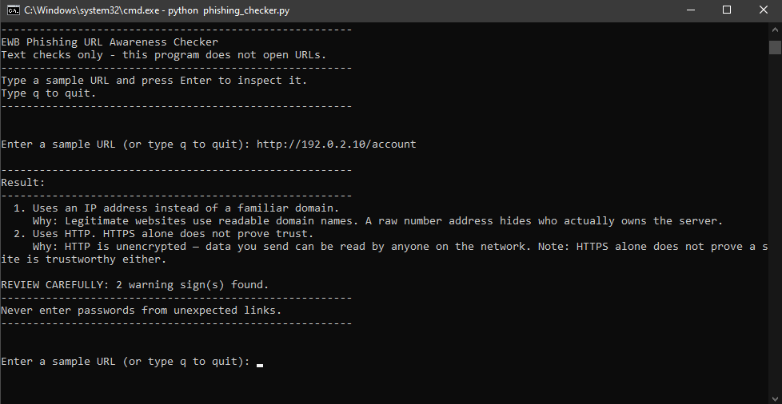
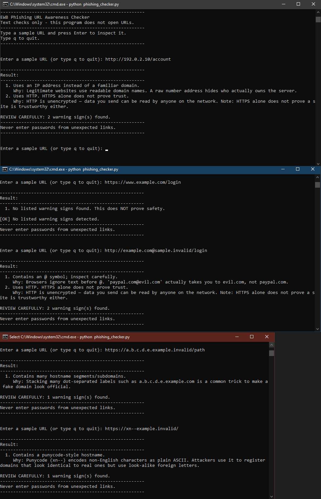

# Phishing URL Detector


A command-line cybersecurity tool that analyses URLs for phishing indicators.
Two versions are included: a focused six-check awareness checker and a full
ten-check advanced analyser with weighted risk scoring.

---

## Overview

Phishing attacks trick users into visiting fake websites that impersonate
legitimate services to steal credentials, card details, or OTPs. Attackers
craft URLs that look convincing at a glance but contain subtle red flags in
their structure.

This project provides two tools to detect those red flags through text-based
URL analysis — no API keys, no external databases, no internet connection
required for the core checker.

| File | Purpose | Checks | Output |
|------|---------|--------|--------|
| `phishing_checker.py` | Awareness checker — focused and educational | 6 | Plain text warnings with explanations |
| `phishing_detector_advanced.py` | Advanced analyser — comprehensive threat assessment | 10 | Colour-coded report with risk score and verdict |

---

## Project Structure

```
Phishing-URL-Detector/
│
├── phishing_checker.py            # Six-check awareness tool (EWB submission)
├── phishing_detector_advanced.py  # Ten-check advanced analyser with risk scoring
├── requirements.txt               # Dependency notes
├── LICENSE
│
├── tests/
│   └── test_samples.md            # Five verified test cases with results
│
└── screenshots/
    ├── sample_run.png             # Terminal output — phishing_checker.py
    └── test_results.png           # All five test cases in terminal
```

---

## Quick Start

```bash
# Run the awareness checker (no dependencies)
python phishing_checker.py

# Run the advanced analyser
pip install requests          # optional — for HTTP header checks
python phishing_detector_advanced.py
```

---

## Phishing URL Checker

A text-only, educational command-line tool that inspects a URL string for
six warning signs. Designed for clarity and explainability — every finding
includes a plain-English reason.

**The program never opens URLs, sends network requests, or connects to the internet.**

### Six Warning Checks

| # | Check | What It Detects |
|---|-------|-----------------|
| 1 | `@` symbol | Browser ignores text before `@` — `paypal.com@evil.com` visits `evil.com` |
| 2 | URL length | URLs over 100 characters hide the real destination to the right |
| 3 | IP address hostname | Raw IPs like `192.0.2.10` conceal site ownership |
| 4 | Hostname segments | Five or more dot-separated labels signal subdomain stacking |
| 5 | Punycode (`xn--`) | Encodes look-alike foreign characters to mimic real domains |
| 6 | HTTP scheme | Unencrypted connection — data is readable in transit |

### Five Improvements

On top of the six checks, the following improvements are implemented:

- **Loop (A)** — Inspect multiple URLs in one session; type `q` to quit
- **Summary (B)** — Prints `REVIEW CAREFULLY: N warning sign(s) found` after findings
- **Crash protection (C)** — Handles malformed input like `http://[bad` without crashing
- **Explanations (D)** — Prints a plain-English `Why:` note under each warning
- **Formatted output (E)** — Numbered findings, separator lines, clean layout

### How to Run

```bash
python phishing_checker.py
```

### Example Output

```
-------------------------------------------------------
EWB Phishing URL Awareness Checker
Text checks only - this program does not open URLs.
-------------------------------------------------------
Type a sample URL and press Enter to inspect it.
Type q to quit.
-------------------------------------------------------

Enter a sample URL (or type q to quit): http://192.0.2.10/account

-------------------------------------------------------
Result:
-------------------------------------------------------
  1. Uses an IP address instead of a familiar domain.
     Why: Legitimate websites use readable domain names. A raw number
          address hides who actually owns the server.
  2. Uses HTTP. HTTPS alone does not prove trust.
     Why: HTTP is unencrypted — data you send can be read by anyone
          on the network.

REVIEW CAREFULLY: 2 warning sign(s) found.
-------------------------------------------------------
Never enter passwords from unexpected links.
-------------------------------------------------------
```

### Test Results

| # | Input | Expected | Actual | Result |
|---|-------|----------|--------|--------|
| 1 | `https://www.example.com/login` | No warnings | No listed warning signs found. | PASS |
| 2 | `http://192.0.2.10/account` | IP + HTTP | IP address + HTTP warnings | PASS |
| 3 | `http://example.com@sample.invalid/login` | @ + HTTP | @ symbol + HTTP warnings | PASS |
| 4 | `https://a.b.c.d.e.example.invalid/path` | Many segments | Many hostname segments/subdomains | PASS |
| 5 | `https://xn--example.invalid/` | Punycode | Punycode-style hostname | PASS |

Full evidence with notes: [tests/test_samples.md](tests/test_samples.md)

### Screenshots




### Limitations

This tool checks six structural patterns only. It does not visit URLs, scan
for malware, query reputation databases, or connect to the internet.

> **"No listed warning signs found" does NOT mean a URL is safe.**
> A carefully crafted phishing URL can pass all six checks while still being
> malicious. This tool is an educational awareness aid, not a security guarantee.

### Ethical Use

- Test only with the sample URLs provided in the test file.
- Do not probe websites or networks without explicit written authorisation.
- Do not use this tool to craft or test real phishing attacks.
- For defensive and educational purposes only.

---

## Advanced Version — Phishing Detector Advanced

A comprehensive URL threat analyser that goes beyond structural checks.
It runs ten independent indicators, assigns a severity level to each, and
computes a cumulative risk score that maps to one of five verdict levels.

### What Makes It Advanced

- **10 checks** instead of 6 — covers TLD abuse, brand impersonation, shorteners, and DNS
- **Weighted risk scoring** — HIGH indicators score more than MEDIUM or LOW
- **Five verdict levels** — granular output from "Likely Safe" to "Phishing Detected"
- **Trusted domain whitelist** — eliminates false positives for known legitimate sites
- **DNS resolution check** — detects domains that do not exist at all
- **Colour-coded terminal output** — immediate visual risk assessment

### How to Run

```bash
# Optional: install requests for HTTP header checks
pip install requests

python phishing_detector_advanced.py
```

### The Ten Checks

| # | Check | Severity | What It Catches |
|---|-------|----------|-----------------|
| 1 | IP-based URL | HIGH | `http://192.168.1.1/login` — raw IPs hide site ownership |
| 2 | Suspicious TLD | HIGH | `.xyz`, `.tk`, `.ml` — free TLDs heavily abused by phishers |
| 3 | Brand in subdomain | HIGH | `paypal.evil.com` — brand name is in the subdomain, not the real domain |
| 4 | Brand in path | MEDIUM | `evil.com/paypal/login` — path mimics a legitimate service |
| 5 | Excessive subdomains | HIGH / MEDIUM | 4+ subdomains obscure the real domain |
| 6 | URL shortener | MEDIUM | `bit.ly/xyz` — destination is hidden behind a redirect |
| 7 | HTTP scheme | MEDIUM | Unencrypted connection — login pages must use HTTPS |
| 8 | Long URL | MEDIUM / LOW | 75+ characters — padded to bury the real domain |
| 9 | Special characters | HIGH / MEDIUM | `@` redirects browsers; excessive hyphens signal typosquatting |
| 10 | DNS resolution | MEDIUM | Domain does not exist — possibly a fresh phishing domain |

### Risk Scoring System

Every triggered check contributes points based on its severity:

| Severity | Points |
|----------|--------|
| HIGH | 3 |
| MEDIUM | 2 |
| LOW | 1 |

### Verdict Levels

| Score | Verdict |
|-------|---------|
| 0 | Likely Safe |
| 1 – 2 | Low Risk |
| 3 – 5 | Suspicious |
| 6 – 8 | High Risk |
| 9+ | Phishing Detected |

### Example URLs to Test

```bash
# Trusted — whitelisted, skips all checks
https://www.google.com

# Phishing — brand in subdomain, suspicious TLD, HTTP
http://paypal.secure-login.verify.xyz/account

# Suspicious — raw IP, HTTP
http://192.168.1.1/login

# Suspicious — URL shortener
https://bit.ly/free-gift-2026
```

### Example Output

```
╔══════════════════════════════════════════╗
║     📧 PHISHING URL DETECTOR            ║
║     Stay Safe — Verify Before You Click ║
╚══════════════════════════════════════════╝

  Try these example URLs to see the detector in action:
  ✅ Safe    : https://www.google.com
  🚨 Phish   : http://paypal.secure-login.verify.xyz/account
  ⚠  Suspect : http://192.168.1.1/login

  Type 'quit' to exit.

  Enter URL to analyse: http://paypal.secure-login.verify.xyz/account

  ══════════════════════════════════════════════════════════════
  URL ANALYSIS REPORT
  ══════════════════════════════════════════════════════════════
  URL        : http://paypal.secure-login.verify.xyz/account
  Domain     : paypal.secure-login.verify.xyz
  Base Domain: verify.xyz
  Scheme     : HTTP
  Score      : 11 risk points

  Verdict    : 🚨  PHISHING DETECTED
  ══════════════════════════════════════════════════════════════

  Indicators Found (4):

  [HIGH]   Domain uses suspicious TLD: '.xyz' (common in phishing)
  [HIGH]   Brand name 'paypal' found in subdomain — classic phishing trick!
  [HIGH]   Excessive subdomains (3) — used to hide real domain
  [MEDIUM] URL uses HTTP (not HTTPS) — data sent unencrypted

  ──────────────────────────────────────────────────────────────
  ⛔ DO NOT visit this URL or enter any credentials!
     → Report: https://safebrowsing.google.com/safebrowsing/report_phish/
  ══════════════════════════════════════════════════════════════
```

### What I Learned

- How phishers construct convincing URLs using subdomains and lookalike TLDs
- URL structure in depth: scheme, netloc, subdomain, base domain, path, query string
- Python's `urllib.parse` module for decomposing URLs into components
- Regex patterns for IP address detection
- How weighted scoring systems model threat severity in real security tools
- The difference between heuristic detection and signature-based detection
- Why whitelisting known-good domains is critical to avoiding false positives

---

## EWB Cybersecurity Internship

`phishing_checker.py` was submitted as the final project deliverable for the
EWB Cybersecurity Internship (2026). It implements the six URL warning checks
and five improvements specified in the internship guide, with full test
evidence and screenshots.

- Submission file: [`phishing_checker.py`](phishing_checker.py)
- Test evidence: [`tests/test_samples.md`](tests/test_samples.md)

---

## Ethical Use and Limitations

This project is for **defensive and educational purposes only**.

- Never use this tool to craft, test, or distribute phishing attacks.
- Do not scan or probe websites or networks without explicit written authorisation.
- Results are heuristic — a clean result does not guarantee a URL is safe.
- Always cross-verify suspicious URLs through multiple sources before acting.

For real-time phishing detection and verification, also use:
- [Google Safe Browsing](https://safebrowsing.google.com/)
- [VirusTotal URL Scanner](https://www.virustotal.com/)

---

## Author

**Kushal Soni**
|| GitHub: [kushal-soni-official](https://github.com/kushal-soni-official)

---

## License

MIT — free to use, modify, and distribute with attribution.
